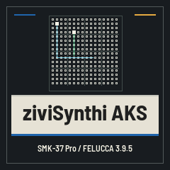

# ziviSynthi AKS

[Português](README.md)

A 16 × 16 pin-matrix synthesizer for the **M‑VAVE SMK‑37 Pro**, created by **Victor Valentim** and inspired by the EMS Synthi AKS. Three oscillators, a resonant filter, ring modulation, a trapezoid envelope and reverb. Includes a KS sequencer, a 64-step SEQ, ARP, 128 instrument presets and four USB effects.

**3.9.5 pre-release.** The build and updater have been verified on the host. Flashing, analog output and Bluetooth still need on-device validation. [Notices and credits](NOTICES.md#english)

## Start here

| Task | Where to go |
|---|---|
| Try or install | Open the site via the repository’s **About** link for Web Studio, documentation and downloads. Click **Experimentar / Try** to play in the browser without hardware. To flash the Pro, connect it over USB and choose **Instalar firmware**. [Installation](docs/usage/INSTALL.en.md) |
| Play and edit | **K4** in Overview selects presets. **GLOBE** opens the modules. **PITCH** and **MOD** operate Stick X/Y. [Manual](docs/usage/SMK37_FELUCCA_BANCADA.en.md) |
| Build and contribute | `make test` checks the C core and editor. `make serve` opens the Studio on localhost. The FM‑1 target builds a Linux simulator. [Build and GitHub Actions](docs/development/GITHUB_RELEASE.en.md) |

[Documentation](docs/README.md#english) · [3.9.5 release notes](docs/releases/v3.9.5.md#english) · [Changelog](CHANGELOG.md) · [GPL‑3.0‑only](LICENSE)
