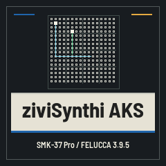

# ziviSynthi AKS

[English](README.en.md)

Sintetizador de matriz 16 × 16 para o **M‑VAVE SMK‑37 Pro**, criado por **Victor Valentim** e inspirado no EMS Synthi AKS. Três osciladores, filtro ressonante, modulador em anel, envoltória trapezoidal e reverberação. Inclui sequenciador KS, SEQ de 64 passos, ARP, 128 timbres e quatro efeitos USB.

**3.9.5 pré-lançamento.** Compilação e atualizador verificados em host. A validação no teclado inclui gravação, saída analógica e Bluetooth e segue em aberto. [Avisos e créditos](NOTICES.md#português)

## Comece aqui

| Atividade | Onde ir |
|---|---|
| Experimentar ou instalar | Abra o site pelo link em **About** no GitHub. A página reúne o Web Studio, a documentação e os downloads. Clique em **Experimentar / Try** para tocar no navegador sem o teclado. Para gravar no Pro, use **Instalar firmware** com o teclado ligado por USB. [Guia de instalação](docs/usage/INSTALL.md) |
| Tocar e editar | **K4** no Overview percorre os presets. **GLOBE** abre os módulos. **PITCH** e **MOD** operam Stick X/Y. [Manual](docs/usage/SMK37_FELUCCA_BANCADA.md) |
| Compilar e contribuir | `make test` verifica o núcleo C e o editor. `make serve` abre o Studio em localhost. O alvo FM‑1 gera um simulador Linux. [Compilação e GitHub Actions](docs/development/GITHUB_RELEASE.md) |

[Documentação](docs/README.md#português) · [Notas da 3.9.5](docs/releases/v3.9.5.md) · [Histórico](CHANGELOG.md) · [GPL‑3.0‑only](LICENSE)
