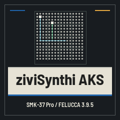

# ziviSynthi AKS

[English](README.md)

[](https://doi.org/10.5281/zenodo.24617383)
[](LICENSE)
[](https://github.com/vicvalentim/ziviSynthi-AKS/actions/workflows/ci.yml)
[](https://github.com/vicvalentim/ziviSynthi-AKS/releases/tag/v3.9.7)
[Web Studio](https://vicvalentim.github.io/ziviSynthi-AKS/pt/studio/#try)

Sintetizador de matriz 16 × 16 para o **M‑VAVE SMK‑37 Pro**, criado por **Victor Valentim** e inspirado no EMS Synthi AKS. Três osciladores, filtro ressonante, modulador em anel, envoltória trapezoidal e reverberação. Inclui sequenciador KS, SEQ de 64 passos, ARP, 128 timbres e quatro efeitos USB.

**Versão 3.9.7** para o M‑VAVE SMK‑37 Pro. [Notas da versão](docs/releases/v3.9.7.md#português) · [Avisos e créditos](NOTICES.md#português)

## Comece aqui

| Atividade | Onde ir |
|---|---|
| Experimentar ou instalar | Abra o [site do projeto](https://vicvalentim.github.io/ziviSynthi-AKS/pt/). A página reúne o Web Studio, a documentação e os downloads. Clique em **Experimentar / Try** para tocar no navegador sem o teclado. Para gravar no Pro, use **Instalar firmware** com o teclado ligado por USB. [Guia de instalação](docs/usage/INSTALL.md) |
| Tocar e editar | **K4** no Overview percorre os presets. **GLOBE** abre os módulos. **PITCH** e **MOD** operam Stick X/Y. [Manual](docs/usage/SMK37_FELUCCA_BANCADA.md) |
| Usar o Studio no navegador | Em **Patch Matrix → Preset do SMK**, escolha um dos 132 patches de fábrica. No Try, salve ou carregue um SEQ para reproduzi-lo no KS. Os USB FX processam um arquivo de áudio local. [Guia do KS](docs/usage/KS_SEQUENCER.md) |
| Compilar e contribuir | `make test` verifica o núcleo C e o editor. `make serve` abre o Studio em localhost. [Compilação e GitHub Actions](docs/development/GITHUB_RELEASE.md) |



[Documentação](docs/README.pt.md) · [Versões publicadas](https://github.com/vicvalentim/ziviSynthi-AKS/releases) · [Histórico](CHANGELOG.md) · [GPL‑3.0‑only](LICENSE)

## Como citar

Cite o depósito da versão 3.9.7 ao se referir a essa versão em trabalhos acadêmicos ou artísticos. O selo identifica a série de versões.

**APA**

Soares Valentim, V. H. (2026). ziviSynthi AKS: An Open-Source Pin-Matrix Synthesizer Firmware Inspired by the EMS Synthi AKS (Version 3.9.7) [Computer software]. Zenodo. https://doi.org/10.5281/zenodo.24617384

**ABNT**

SOARES VALENTIM, Victor Hugo. ziviSynthi AKS: An Open-Source Pin-Matrix Synthesizer Firmware Inspired by the EMS Synthi AKS. Versão 3.9.7. Zenodo, 2026. Software. DOI: 10.5281/zenodo.24617384.

**BibTeX**

```bibtex
@software{soaresvalentim_zivisynthi_aks_3_9_7,
  author = {Soares Valentim, Victor Hugo},
  title = {{ziviSynthi AKS: An Open-Source Pin-Matrix Synthesizer Firmware Inspired by the EMS Synthi AKS}},
  version = {3.9.7},
  year = {2026},
  publisher = {Zenodo},
  doi = {10.5281/zenodo.24617384},
  url = {https://doi.org/10.5281/zenodo.24617384}
}
```

## Preservação e indexação

O código-fonte está preservado no Zenodo. O firmware integra o catálogo altstrument.

[Zenodo](https://zenodo.org/records/24617384) · [altstrument](https://altstrument.org/firmware/m-vave-smk-37/zivisynthi-aks) · [Pesquisa e preservação](docs/usage/SCIENTIFIC_PUBLICATION.md)
